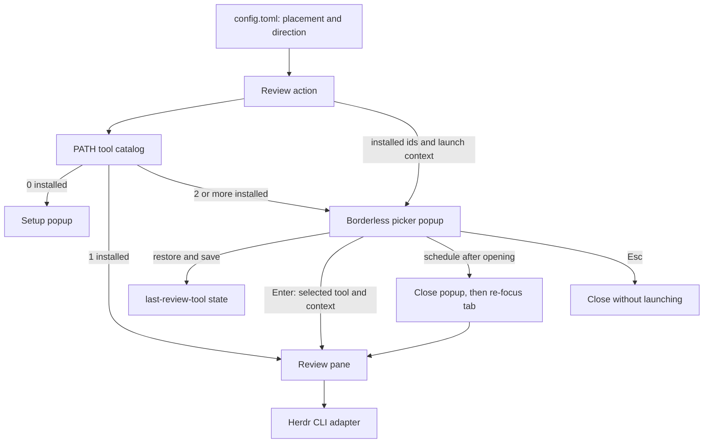

# Design: Choose an Installed Review Tool

## Approach

The action will enumerate the existing `lumen`, `revdiff`, and `tuicr` catalog through the PATH executable detection already used by the project. Zero matches route to the existing `setup` popup with its current no-tool guidance. One match bypasses selection and passes that id as `HERDR_REVIEW_TOOL` when opening the review pane. Multiple matches open a dedicated picker popup; the action does not infer a choice from config.

The picker stores the last successfully selected tool id in the herdr plugin state directory. On open it highlights that id if it remains among the discovered tools, otherwise it highlights the first discovered tool. Up and Down move the highlight through the available rows; Enter persists the selected id and opens the review pane; Esc exits cleanly without opening a review pane. If multiple tools exist but interactive input is unavailable, the action reports that selection is unavailable and exits without launching.

The existing flat config reader remains for `placement` and `direction`; it ignores the obsolete `tool` key. Both picker and setup dialogs avoid reading the herdr theme configuration. They use terminal-default colors and basic text attributes, without palette-specific colors. The picker is borderless and keeps its content compact.

## Data and integration

- Available tools use the existing catalog ids and PATH detection order: `lumen`, `revdiff`, `tuicr`.
- The selected id continues through the existing `HERDR_REVIEW_TOOL` environment variable.
- Last-choice state is a single tool id in the plugin state directory. Missing or uninstalled remembered values fall back to the first installed tool; storage failures do not prevent launch.
- Placement and direction remain sourced from `config.toml` and continue to control review-pane placement.

## Architecture

The action owns PATH discovery and count-based routing. The picker owns keyboard selection and last-choice persistence; it receives the installed ids and launch context from the action, then calls the Herdr adapter only after Enter. After the review pane opens, a detached helper closes the modal popup through the socket API and then focuses the new tab, so popup teardown cannot restore the previous tab's focus. The setup popup remains a separate no-tool path. Both popups render with terminal-default colors and do not read herdr theme configuration.

## Files to touch

- `src/features/review/mod.rs` — discovery branches, picker/setup routing, and review-pane launch with the selected tool.
- `src/settings.rs` — remove tool configuration parsing and retain placement/direction parsing; this module defines settings and owns their loading, so it is not named as a system adapter.
- `src/adapters/tool.rs` — expose installed catalog tools to the action without changing PATH-only detection semantics.
- `src/features/setup.rs` — remove theme resolution and draw the setup popup with terminal-default styling.
- `(removed setup theme module)` — remove herdr theme configuration parsing and palette selection.
- `src/features/picker.rs` — new picker rendering, key handling, and last-choice state access.
- `openspec/changes/choose-installed-review-tool/specs/review-tool-picker/spec.md` — picker capability delta; the canonical delta path for this change.
- `src/main.rs` — dispatch the picker entrypoint if pane dispatch requires a registration.
- `herdr-plugin.toml` — declare the picker popup entrypoint and size if a dedicated popup pane is needed.
- `tests/e2e.rs` — cover installed-tool counts, selection/cancel behavior, state fallback, and config/theme independence.
- `openspec/specs/review-launch/spec.md` — replace config-selected launch requirements.
- `openspec/specs/placement-config/spec.md` — remove tool-key behavior and preserve placement/direction.
- `openspec/specs/setup-dialog/spec.md` — specify theme-independent safe styling for the no-tool setup popup.

## Trade-offs

The dedicated popup keeps tool choice separate from the no-tool setup dialog, which retains its current install guidance. Its outer width is 38 terminal cells, leaving 36 content cells for the footer line; selection highlighting fills the full content row. Terminal-default colors offer fewer decorative options but remain legible under the active terminal palette. Last-choice memory adds a small state file but avoids repeating navigation when several tools are installed.
